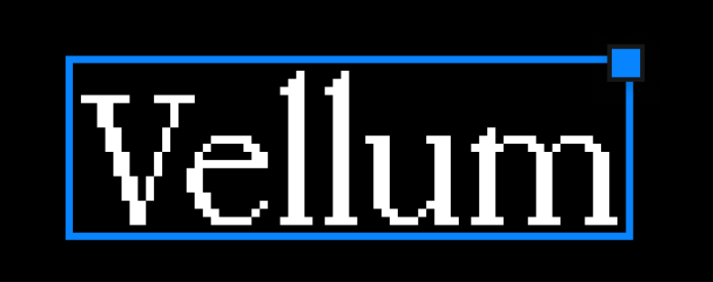

<p align="center">
  
</p>

# Vellum for Edge

Inspect elements, write annotations, and preview CSS changes on a web page.

This private extension derives from `coreai-microsoft/mini-foundry`, not the
standalone Vellum repository. The initial `src/vellum/` import is unchanged from
`packages/vellum/src/` at commit `0104e3b1`.

Design source: the Mini Foundry implementation. The requested CoreAI DS Vellum
Figma source page could not be located. The destination file is
`ZRXd0l2ccHC388qwGBoNlc`, page `0:1`. The browser-state board is frame `63:101`,
with 28 editable state variants in component set `63:3054` on the
`Vellum state components` page. The initial inventory was built before
implementation, then replaced with running-browser states. This is not a claim
that the CoreAI DS source was copied.

The board includes toolbar, selection, annotations, tags, CSS editing, settings,
themes, shortcuts, component gallery, clipboard feedback, and extension popup
states. Figma uses JetBrains Mono where the captured Menlo font was unavailable.
The source remains authoritative for interactions and additional edge cases.

Existing source attribution and ownership are retained. No license grant is
implied by this private extraction.

## Install in Edge

Requires Node.js 22 or newer and Microsoft Edge 131 or newer.

```sh
npm ci
npm run build
```

Open `edge://extensions`, enable **Developer mode**, select **Load unpacked**,
and choose this repository's `dist/` folder. Pin Vellum in the extension menu.
Open an ordinary web page, select Vellum, and choose **Start Vellum**.
Use the same menu to stop it. A reload requires starting it again.

`npm run package` produces `artifacts/vellum-edge.zip` for manual distribution.
The extension is not published to the Edge Add-ons store.

## Features

- Element selection and annotation markers.
- Create, edit, delete, tag, and filter annotations.
- Copy feedback with element and available React component context.
- DOM layer tree on ordinary pages; React tree when React metadata is available.
- Applied CSS editing, authored CSS rules, copyable diffs, and reset.
- Draggable toolbar, keyboard shortcuts, dark/light themes, and component gallery.
- Extension popup with ready, starting, active, blocked, and error states.
- Visible save/copy failures. Failed copies never clear annotations.

Stop restores CSS overrides and Vellum anchor names. The sidebar overlays the
page rather than changing the host layout.

| Shortcut | Action |
| --- | --- |
| `S` | Select an element |
| `H` | Show or hide markers |
| `L` | Show or hide the sidebar |
| `1` / `2` | Annotations / Editor |
| `/` | Settings |
| `C` | Copy feedback |
| `X`, then `X` | Clear feedback |
| `Escape` | Cancel selection |
| `Ctrl` / `Cmd` + `Enter` | Save an annotation |

Single-key shortcuts are ignored while typing in an input or editable region.

## Storage and permissions

No backend, telemetry, or account is required. Notes are stored in this
extension's `chrome.storage.local`, not in the website's local storage.
Annotations are scoped to origin, pathname, query, and hash. Settings and tags
are scoped to the origin. There is no automatic import from the embedded tool.

The manifest requests `activeTab`, `scripting`, `storage`, and `clipboardWrite`.
There are no persistent host permissions or always-on content scripts. Starting
Vellum grants temporary access to the current tab.

The inspector runs in the page's JavaScript world to read React metadata.
A separate isolated script handles storage through a bounded, validated message
protocol. The page can see its displayed notes and can interact with this
same-page bridge. Do not use annotations to store secrets. The bridge does not
expose other origins, arbitrary extension storage keys, or extension APIs.

## Limits

- Browser-internal pages, extension stores, PDFs, and file URLs are not supported.
- Inspection is limited to the top document. Cross-origin frames and closed
  shadow roots are not traversed.
- React names and source locations depend on metadata available in the page.
  Production bundles may not provide readable names or source maps.
- Cross-origin stylesheets may not expose their authored rules to the page.
  You can still add explicit inline overrides in Applied CSS.
- Notes use DOM selectors. Large page restructures can leave notes without a
  matching target. Notes remain in the list and can still be copied or deleted.
- Two tabs editing the same page share storage. The last save wins.
- Mini Foundry's host-specific feature/variant routing is retained in the source
  import but is not a browser-extension feature.

## Development and verification

```sh
npm run typecheck
npm test
npm run build
npm run test:browser
```

Browser checks use installed Microsoft Edge in a separate temporary profile.
They load the actual extension, trigger its browser action, and exercise the
real popup and storage. They do not change the normal Edge profile.

For Chromium:

```sh
npx playwright install chromium
VELLUM_BROWSER=chromium npm run test:browser
```

Tests use a local example site, not private work pages. Captures go to
`artifacts/states/`. After browser checks, `node scripts/state-board.mjs` creates
an editable HTML state board. `npm run preview` serves it at
`http://127.0.0.1:5198/board`. That developer-only board loads Figma's capture
script; the packaged extension never does.

Source changes for the extension live in `src/extension/`. `src/vellum/` retains
the source component layout and design tokens. The import commit separates the
original library from browser-specific changes.
